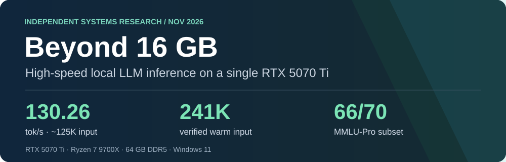
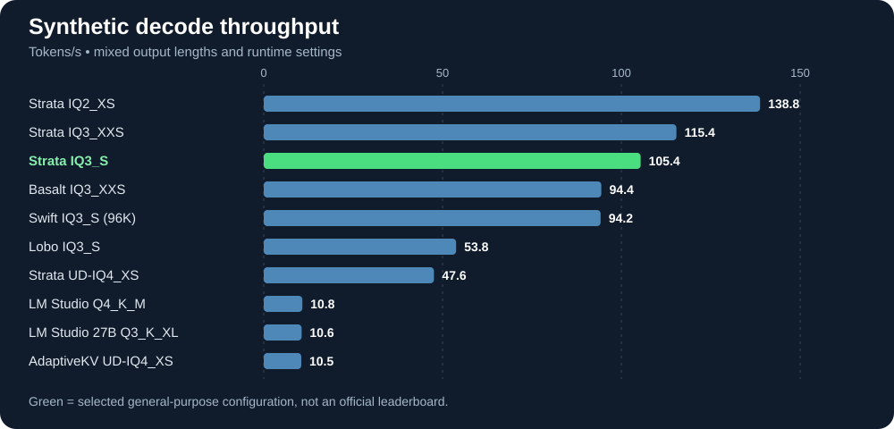
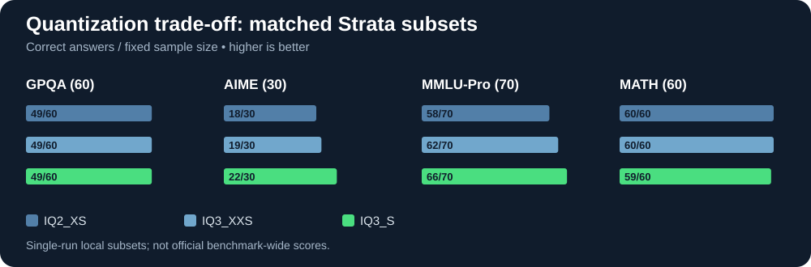
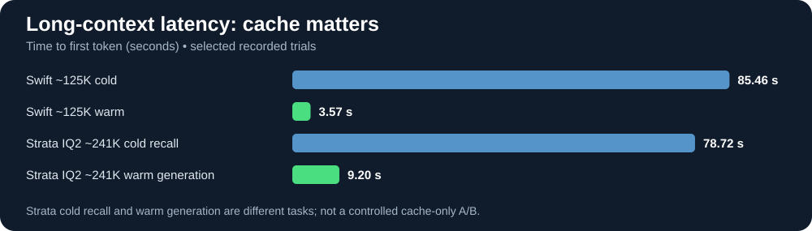

<p align="center">
  
</p>

<h1 align="center">Beyond 16GB</h1>
<p align="center"><b>High-speed local LLM inference on a single RTX 5070 Ti</b></p>
<p align="center">Independent experimental research · November 2026</p>

<p align="center">
  
  
  
  
</p>
<p align="center">
  <a href="README.zh-TW.md">繁體中文</a> · <a href="METHODOLOGY.md">Methodology</a> · <a href="benchmarks.csv">Benchmark CSV</a> · <a href="data/context-trials.csv">Context trials</a> · <a href="https://huggingface.co/datasets/Whatever0625/rtx5070ti-llm-benchmarks">Hugging Face (dataset pending upload)</a>
</p>

---

## Abstract

Can a single consumer GPU with 16 GB of VRAM support high-speed local language-model inference while preserving useful reasoning quality and accommodating unusually long input sequences? This project explores that question through a series of local experiments covering quantization, speculative decoding, KV-cache memory management, long-context retrieval, coding agents, and serving infrastructure.

The starting baseline was approximately 10.8 decode tokens/s on LM Studio Q4_K_M in the synthetic comparison. Subsequent experiments with alternative model architectures and runtimes exceeded 100 tokens/s at 125K-class inputs, and selected cached workloads exceeded 230K input tokens. The final general-purpose configuration was chosen for its observed quality-throughput balance rather than headline speed alone.

> [!IMPORTANT]
> This is an independent experimental report, not a model release, official leaderboard, or claim of equivalence to commercial frontier models. The published data include historical aggregate summaries and 155 allowlisted per-trial metric records extracted directly from six original JSONL logs. Runtime, architecture, cache conditions and output lengths differ across some configurations.

## Research highlights

| Measured outcome | Result | Interpretation |
|---|---:|---|
| Sustained long output, ~125K input | **130.26 tok/s** | Median of three 2,048-token Swift/NInfer generations; one cold, two warm |
| ~241K input generation | **134.3 tok/s** | Strata IQ2_XS, reused prefix, 1,732 generated tokens |
| Near-1M context retrieval | **985,092 tokens** | Warm-cache exact-marker result; not a cold 1M throughput benchmark |
| Matched MMLU-Pro subset | **66/70** | Strata IQ3_S, 94.3% on the fixed 70 questions |
| Coding-agent reproduction | **28/29** | Local QuixBugs repair result, 206 seconds |

## Reproducibility release

**155 per-trial records · 6 historical log extracts · original reference harness**

| Resource | What it provides |
|---|---|
| [Historical per-trial metrics](data/trials/README.md) | Six JSONL extracts with original numerical precision, token counts, timing, correctness, and selected termination metadata |
| [Runtime and model manifest](docs/runtime-manifest.md) | Recorded engine versions, quantization/context settings, and the NInfer model revision and SHA-256 |
| [Run the benchmark](reproduce/README.md) | A dependency-free Python reference harness for local streaming APIs, synthetic retrieval and generation |
| [Benchmark source](reproduce/benchmark.py) | Original reference implementation; offline self-test passed on the experiment PC |

```bash
python reproduce/benchmark.py --self-test
python reproduce/benchmark.py --model YOUR_LOCAL_MODEL_ID --task recall --records 100 --repeat 2
```

**Audit:** rereading the public JSONL files reproduces the 130.26 tok/s median across three long NInfer generations, the 17/17/18/18 correct counts across the four 24-question reasoning-effort groups, and the 5/7/7 correct counts across the three eight-question thinking-budget groups. The reference harness has passed offline checks; a live endpoint test has not yet been performed.

The six extracts retain selected measurement fields, not complete original prompts or model outputs. The new harness demonstrates the method and is not an exact copy of the historical runner.

## Explore the research

| Research area | Detailed report | Supporting data |
|---|---|---|
| Inference optimization | [Engine comparisons, MTP sweeps and memory constraints](docs/inference-optimization.md) | [MTP sweep CSV](data/mtp-sweep.csv) |
| Long-context inference | [128K, 256K and near-1M trials](docs/long-context.md) | [Context trial CSV](data/context-trials.csv) |
| Model intelligence and coding | [Quality, reasoning budgets, agents and vision](docs/model-evaluation.md) | [Aggregate benchmark CSV](benchmarks.csv) |
| Serving infrastructure | [Architecture and integration status](docs/system-architecture.md) | [Methodology](METHODOLOGY.md) |

## Experimental progression

| Phase | Research question | Outcome |
|---|---|---|
| Baseline | How fast is the original Q4 model? | Established a slow reference configuration; identified performance constraints |
| Adaptive KV / stock CUDA | Can cache management and MTP improve inference? | Short and medium prompts exceeded 100 tok/s; stock 128K prefill failed |
| NInfer / Swift | Can ~125K input fit and sustain long generation? | Three 2,048-output trials completed at 123.81–164.45 tok/s |
| Strata / quantization sweep | Which configuration offers the best local speed-quality trade-off? | IQ3_S selected; IQ2_XS was faster but answered fewer matched MMLU questions |
| Basalt and further validation | Is another engine a better deployment candidate? | Basalt completed matched quality subsets and ~94.4 tok/s median synthetic generation |
| Serving and extended context | Can the system serve real applications and handle near-1M inputs? | Warm-cache retrieval succeeded; some 1M speculation presets failed and were restored |

## Hardware

| Component | Configuration |
|---|---|
| GPU | Single NVIDIA RTX 5070 Ti, 16 GB VRAM |
| CPU | AMD Ryzen 7 9700X |
| RAM | 64 GB DDR5 |
| OS | Windows 11 |

## 1. Quantization and engine comparison

<p align="center"></p>

| Configuration | Synthetic decode (tokens/s) | GPQA | AIME | MMLU-Pro | MATH |
|---|---:|---:|---:|---:|---:|
| Strata IQ2_XS | 138.8 | 49/60 | 18/30 | 58/70 | 60/60 |
| Strata IQ3_XXS | 115.4 | 49/60 | 19/30 | 62/70 | 60/60 |
| Strata IQ3_S | 105.4 | 49/60 | 22/30 | 66/70 | 59/60 |
| Basalt IQ3_XXS | 94.4 | 49/60 | 22/30 | 62/70 | — |
| Swift IQ3_S (96K) | 94.2 | 43/60 | 17/30 | 59/70 | 57/60 |
| Strata UD-IQ4_XS | 47.6 | 21/25 | 7/12 | 22/24 | 20/20 |
| Lobo IQ3_S | 53.8 | 13/30 | 4/16 | 25/37 | 29/30 |
| LM Studio Q4_K_M | 10.8 | 2/5 | 1/3 | 8/9 | 4/6 |
| LM Studio 27B Q3_K_XL | 10.6 | 1/4 | 1/3 | 6/9 | 3/5 |
| AdaptiveKV UD-IQ4_XS | 10.5 | 1/3 | 1/3 | 6/9 | 5/6 |

These results combine different architectures, context settings, and output lengths (512 or 2,048 tokens); Basalt is the median of four 2,048-token trials. Incomplete subsets are not comparable to completed subsets as official scores. The full-coverage Strata IQ3_S configuration was selected for its measured speed/quality trade-off rather than maximum raw throughput. On the same 70 MMLU-Pro questions, IQ3_S answered eight more correctly than IQ2_XS (paired exact McNemar p=0.0078, exploratory single-run comparison).

<p align="center"></p>

The data motivate a practical choice: IQ3_S is slower than IQ2_XS on this synthetic speed suite, but it answers eight additional MMLU-Pro questions and four additional AIME questions correctly. Neither quantization is proven superior across all tasks.

## 2. Long-context experiments

<p align="center"></p>

| Configuration | Actual input tokens | Output tokens | Decode tok/s | TTFT (s) | Cache |
|---|---:|---:|---:|---:|---|
| Stock IQ3_S 64K | 62,950 | 1,024 | 78.14 | 0.51 | Warm |
| AdaptiveKV IQ4 128K | 125,765 | 203 | 30.44 | 293.28 | Cold |
| Swift/NInfer 128K | 125,783 | 2,048 | 123.81 | 85.46 | Cold |
| Swift/NInfer 128K | 125,778 | 2,048 | 130.26 | 3.57 | Warm |
| Swift/NInfer 128K | 125,779 | 2,048 | 164.45 | 3.52 | Warm |
| Strata IQ2_XS 128K | 120,706 | 2,048 | 134.8 | 8.18 | Partial reuse |
| Strata IQ2_XS 256K | 241,231 | 1,732 | 134.3 | 9.20 | Warm |
| Strata IQ3_S 256K | 230,596 | Not recorded in summary | 99.1 | 5.99 | Warm |

The original stock 128K configuration was aborted during prefill under severe memory pressure. Strata IQ2_XS cold retrieval at 241,232 tokens required 78.72 seconds to first token and correctly retrieved all three markers. A separate near-1M Swift warm-cache test reported 985,092 input tokens, 985,087 cached tokens, 111 output tokens and a correct marker in 2 seconds. No claim of full 1M cold-input validation or comprehensive 1M reasoning is made.

## 3. Coding and reasoning

A same-task reproduction of the AI Pruner experiment used Swift/NInfer rather than the author's original engine and weights.

| Test | Published reference (as recorded in local report) | Local result |
|---|---:|---:|
| QuixBugs repair | 27/29 | 28/29 |
| QuixBugs elapsed | 589 s | 206 s |
| 2048 game logic | 5/5 | 5/5 (95/95 assertions) |
| Tetris syntax/features | 3/3 | 3/3 |
| Math without tools | 4/8 | 3/8 |
| Math with Python tools | 8/8 | 8/8 |

Tetris feature checks do not establish complete game correctness. Tool-assisted mathematics was substantially more reliable than unaided answers in this small sample. Increasing the reasoning budget from 256 to 1,024 improved Swift's hard-task subset from 5/8 to 7/8; 2,048 produced no further gain in that subset.

## 4. What did not work

- Stock 128K prefill was too slow and was aborted.
- NInfer's initial higher-precision KV configuration did not fit the 16 GB GPU; a more compact KV representation was required.
- A later Strata 1M speculative-decoding experiment reduced median throughput from 56.8 to 43.8 tokens/s and failed its quality smoke test. An additional draft configuration failed to start because of memory pressure. Neither experimental preset was retained.
- Some early LM Studio runs selected the wrong model ID. Those results were invalidated; corrected results are shown above.
- The overnight benchmark ended with partial coverage, not a complete evaluation of all configurations.

## 5. Serving architecture

The project evolved toward a single-GPU service with an OpenAI-compatible API, model routing, queueing, streaming, idle model scheduling, and a dashboard for GPU and game-mode control. OpenWebUI and OpenCode were integration targets; image and video pipelines were explored through ComfyUI. Basic vision tests passed on two variants, but full end-to-end OpenCode reliability, concurrent workloads and media generation through every frontend were not established.

## 6. Conclusions

A single 16 GB consumer GPU can achieve sustained generation above 100 tokens/s at 128K-class inputs under selected workloads, and some configurations support substantially longer contexts. Decode throughput alone does not describe perceived latency: cold prefill can take over a minute. Lower precision, model architecture, runtime and cache behavior all affect the result. The chosen general-purpose configuration was Strata IQ3_S, not necessarily the fastest configuration.

No equivalence to GPT or Claude is claimed. These are local experimental results, not official benchmark scores. Unfiltered raw logs and third-party weights are not distributed. Aggregate data is transcribed from historical summaries, with selected per-trial numeric and boolean measurements now available in six sanitized JSONL extracts.

## Reproducibility roadmap

- [x] Publish aggregate quality and throughput data with sample denominators.
- [x] Separate cold and warm long-context trials, including unsuccessful output generation.
- [x] Document runtime versions, reasoning budgets, observed regressions and source manifest.
- [x] Release six reviewed per-trial metric extracts (155 records) and the available runtime/model revision manifest.
- [ ] Expand coverage to remaining historical experiments and independently verifiable model revisions.
- [x] Publish a new reference benchmark harness and pass its offline self-test.
- [ ] Run live endpoint validation and release an exact historical prompt/runner reproduction where redistribution permits.
- [ ] Complete cold near-1M testing, multi-user load tests and frontend integration verification.

Researchers interested in replication should report model architecture, quantization, runtime build, actual input/output token counts, cache state, decode throughput, TTFT and answer correctness separately. Do not compare an output-only speed against another system's end-to-end rate.

## Repository structure

```text
.
├── README.md
├── README.zh-TW.md
├── METHODOLOGY.md
├── benchmarks.csv
├── assets/
│   ├── hero.svg
│   ├── throughput.svg
│   ├── quality.svg
│   └── context-latency.svg
├── data/
│   ├── context-trials.csv
│   ├── mtp-sweep.csv
│   └── trials/             # six JSONL extracts and provenance
├── reproduce/
│   ├── README.md
│   └── benchmark.py
└── docs/
    ├── inference-optimization.md
    ├── long-context.md
    ├── model-evaluation.md
    ├── system-architecture.md
    └── runtime-manifest.md
```

## Citation

If referencing these results, cite the repository title, November 2026 experiment period and the relevant Git commit. Treat this as a non-peer-reviewed experimental report.

## References

- [AI Pruner reproduction source](https://github.com/aipruner/qwen3.8-3bit-test-in-16GB-GPU) — recorded commit `17a3ea44f094c2d9d0e7c09b198ae0397b494679`.
- [QuixBugs](https://github.com/jkoppel/QuixBugs) — recorded commit `4257f44b0ff1181dedaedee6a447e133219fcebf`.
- [Strata](https://github.com/Niko1221/Strata).
- [NInfer](https://github.com/iamwavecut/ninfer-all).

Reference URLs and revisions are taken from the historical experiment records and have not been revalidated for this publication.
