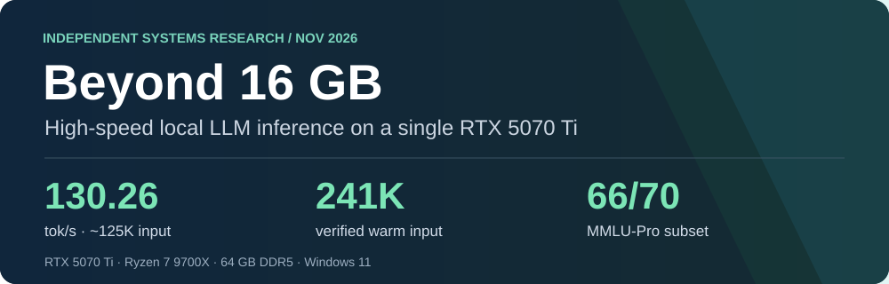
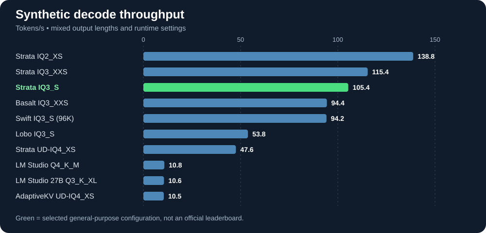
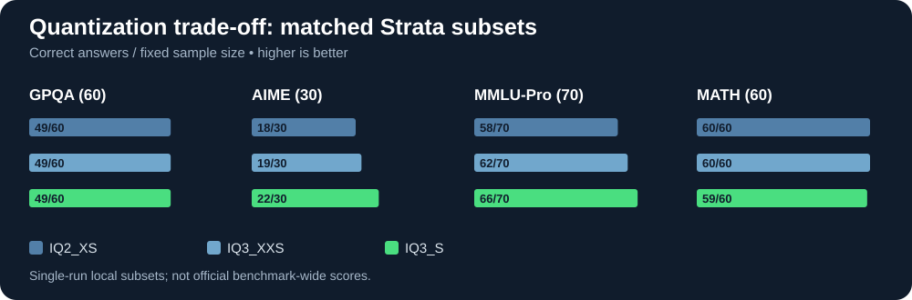
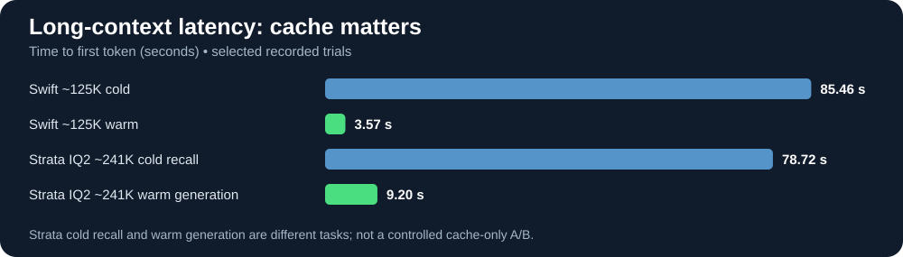

<h1 align="center">突破 16GB：本地大型語言模型高速推論研究</h1>

單張 RTX 5070 Ti · Windows 11 · 2026 年 11 月

<a href="README.md">English</a> · <a href="benchmarks.csv">Benchmark CSV</a> · <a href="METHODOLOGY.md">研究方法</a>

## 研究摘要

本研究探討如何在 16GB VRAM 的消費級顯示卡上，兼顧本地大型語言模型推論速度、長上下文容量與模型品質。研究從 LM Studio Q4 基準出發，逐步比較 AdaptiveKV、stock CUDA、Swift/NInfer、Strata、Lobo 與 Basalt 等不同引擎或模型配置，並進一步研究量化、KV Cache、MTP、推理預算及 Agent 工具使用。

這些結果是歷史本機實驗的彙整，並非官方模型排行榜，也不是嚴格控制所有變因的跨架構測試。

| 核心成果 | 數據 | 實驗限制 |
|---|---:|---|
| 128K 級長輸出速度 | 130.26 tok/s | 約 125K 輸入，3 次 2,048-token 輸出中位數 |
| 256K 級長輸出 | 134.3 tok/s | 241,231 輸入，重用前綴 |
| 近 1M 上下文 | 985,092 tokens | 暖快取單一標記檢索，非冷輸入測速 |
| MMLU-Pro 固定子樣本 | 66/70 | Strata IQ3_S，94.3% |
| QuixBugs 程式修復 | 28/29 | Swift/NInfer，總耗時 206 秒 |

## 研究環境

| 硬體 | 規格 |
|---|---|
| GPU | NVIDIA GeForce RTX 5070 Ti，16GB VRAM |
| CPU | AMD Ryzen 7 9700X |
| RAM | 64GB DDR5 |
| OS | Windows 11 |

## 01 — 推論速度與量化

| 配置 | Decode tok/s | GPQA | AIME | MMLU-Pro | MATH |
|---|---:|---:|---:|---:|---:|
| Strata IQ2_XS | 138.8 | 49/60 | 18/30 | 58/70 | 60/60 |
| Strata IQ3_XXS | 115.4 | 49/60 | 19/30 | 62/70 | 60/60 |
| **Strata IQ3_S** | **105.4** | **49/60** | **22/30** | **66/70** | **59/60** |
| Basalt IQ3_XXS | 94.4 | 49/60 | 22/30 | 62/70 | — |
| Swift IQ3_S (96K) | 94.2 | 43/60 | 17/30 | 59/70 | 57/60 |
| Strata UD-IQ4_XS | 47.6 | 21/25 | 7/12 | 22/24 | 20/20 |
| Lobo IQ3_S | 53.8 | 13/30 | 4/16 | 25/37 | 29/30 |
| LM Studio Q4_K_M | 10.8 | 2/5 | 1/3 | 8/9 | 4/6 |
| LM Studio 27B Q3_K_XL | 10.6 | 1/4 | 1/3 | 6/9 | 3/5 |
| AdaptiveKV UD-IQ4_XS | 10.5 | 1/3 | 1/3 | 6/9 | 5/6 |

不同配置使用不同模型架構、上下文與輸出長度；部分模型測試提前結束，因此保留實際分母，不將未測題目當作零分。Basalt 為四次 2,048-token 生成的中位數。

IQ3_S 在同一組 70 題 MMLU-Pro 比 IQ2_XS 多答對 8 題，但推論速度下降。因此選擇 IQ3_S 作為主要一般用途模型，而不是單純選擇最快的配置。

## 02 — 長上下文與快取

| 配置 | 實際輸入 | Decode tok/s | TTFT | 快取 |
|---|---:|---:|---:|---|
| Swift/NInfer 128K | 125,783 | 123.81 | 85.46s | 冷 |
| Swift/NInfer 128K | 125,778 | 130.26 | 3.57s | 暖 |
| Swift/NInfer 128K | 125,779 | 164.45 | 3.52s | 暖 |
| Strata IQ2_XS 128K | 120,706 | 134.8 | 8.18s | 部分重用 |
| Strata IQ2_XS 256K | 241,231 | 134.3 | 9.20s | 暖 |
| Strata IQ3_S 256K | 230,596 | 99.1 | 5.99s | 暖 |

近 1M 測試記錄為 985,092 輸入、985,087 快取命中、111 輸出、2 秒總耗時及正確標記。這不代表完整 1M 冷輸入速度或全面的長文推理能力。Decode 速度也不能取代包含 prefill 的端到端時間。

## 03 — 推理、程式設計與工具

| 項目 | 本機結果 |
|---|---:|
| QuixBugs 程式修復 | 28/29 |
| QuixBugs 總耗時 | 206 秒 |
| 2048 Python 邏輯 | 5/5；95/95 assertions |
| Tetris 語法／功能檢查 | 3/3 |
| 純數學推理 | 3/8 |
| 使用 Python 工具的數學推理 | 8/8 |
| 工具壓力測試 | 24/24 |

Swift 的 8 題較難推理子測試中，256 thinking budget 得 5/8，而 1,024 與 2,048 均得 7/8。這是小樣本，不代表普遍的推理能力提升。Tetris 檢查亦不代表所有遊戲行為都已驗證。

## 04 — 失敗的實驗也是研究結果

- Stock CUDA 配置在 128K prefill 因顯存壓力中止。
- NInfer 最初較高精度 KV 配置無法載入，改用較緊湊表示後成功。
- MTP draft count 由 4 增至 6 並非所有輸入長度都更快。
- Strata 1M spec6 從 56.8 降至 43.8 tok/s，且品質 smoke test 未通過；DFlash2 另一次嘗試無法啟動。
- 早期部分 LM Studio 測試使用錯誤 model ID，相關結果被作廢。
- 尚未驗證與 GPT／Claude 等級的智慧相同。

## 05 — 單 GPU AI 平台

研究延伸至 OpenAI-compatible API、OpenWebUI、OpenCode、Bionic、模型路由、排隊與串流、資源調度、ComfyUI 圖片影片工作流及 Live Dashboard。兩個 vision 版本的基本圖片顏色辨識通過，但完整 OpenCode 穩定性、多使用者負載及媒體流程仍待驗證。

## 詳細研究文件

| 主題 | 報告 | 數據 |
|---|---|---|
| 推論引擎、MTP、記憶體限制 | [Inference optimization](docs/inference-optimization.md) | [MTP sweep](data/mtp-sweep.csv) |
| 128K、256K、近 1M | [Long context](docs/long-context.md) | [Context trials](data/context-trials.csv) |
| 智慧、推理預算、Agent 與 Vision | [Model evaluation](docs/model-evaluation.md) | [Benchmark CSV](benchmarks.csv) |
| 系統架構 | [System architecture](docs/system-architecture.md) | [Methodology](METHODOLOGY.md) |

本版本提供彙整數據、研究方法及結果分析。尚未公開經過審查的全部原始日誌、測試 harness 和第三方模型權重，因此不能稱為完全可重現的研究套件。引用時請附上 Git commit 版本。
