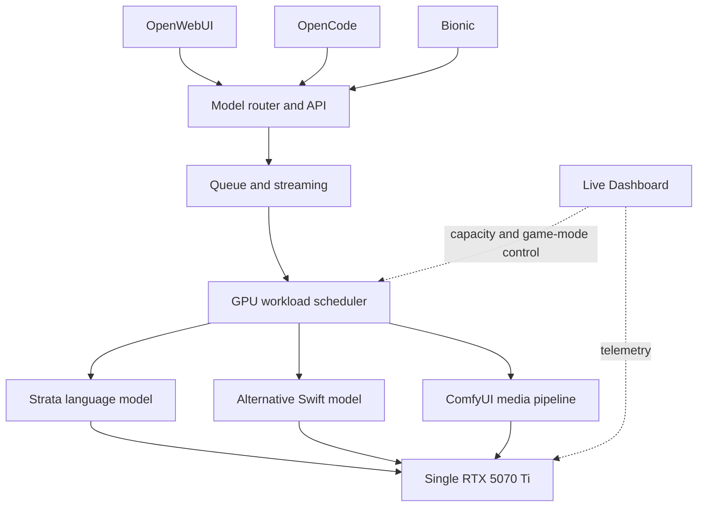

# Single-GPU serving architecture

[← Research overview](../README.md)

The research evolved from model comparison into a practical shared inference service. The diagram describes the design, not a claim that all integrations are operational.

| Subsystem | Evidence / status |
|---|---|
| OpenAI-compatible API | Local inference API trials completed |
| Model selection | Multiple engine and quantization experiments; selected general model |
| Queue and SSE | Implementation work recorded; complete multi-user stress data not reviewed |
| Idle scheduling / game mode | Design and implementation work recorded; full lifecycle validation outstanding |
| Vision | Basic color recognition on two variants passed |
| Image / video | ComfyUI pipeline development and smoke-test artifacts; not a full frontend validation |
| OpenCode | Integration under development; reported stalled requests remain unresolved |
| 1M router | Near-1M warm-cache retrieval recorded; cold input and production stability unverified |

The 16 GB memory budget makes simultaneous full-size model loading undesirable. A production system should isolate workloads, protect service access with authentication, use explicit resource limits and collect queue/latency/VRAM metrics. No private hostnames, credentials or deployment endpoints are distributed here.

## Next validation milestones

- Replay identical long-context prompts across selected engines with fixed output caps and cold/warm cache separation.
- Run concurrent-request load tests, recording queue wait, TTFT, decode rate, error rate and GPU memory separately.
- Validate full frontend-to-backend streaming and tool calling with benign tasks.
- Publish scrubbed per-trial logs, model revisions, runtime settings and an independently runnable benchmark harness.
